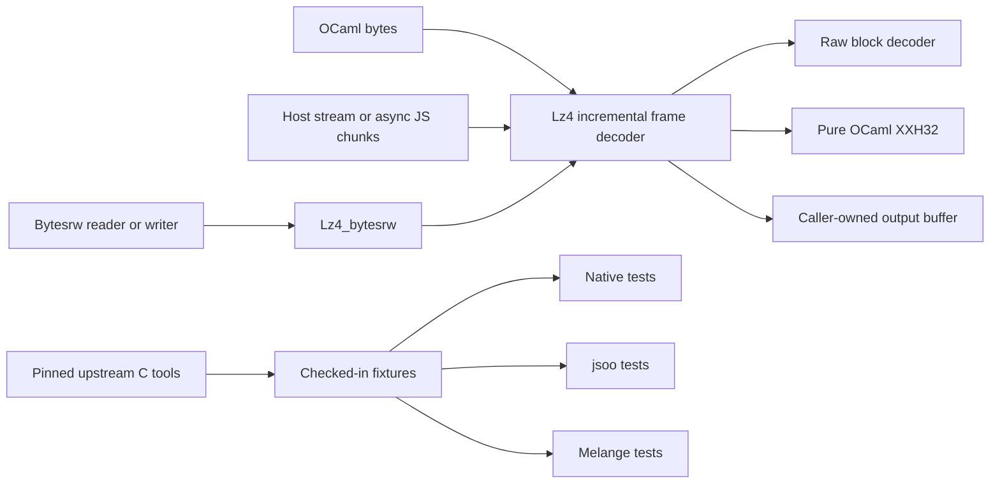

# Pure OCaml LZ4 decompressor

Status: initial design; no implementation yet. 2026-10-13.

Build a standalone, pure OCaml decompression library with the same decoding
source for native OCaml, js_of_ocaml (jsoo), and Melange. Support raw LZ4 blocks
and the modern LZ4 frame format. Use Bytesrw through a separate, optional I/O
adapter. Include the upstream LZ4 repository as a pinned development submodule
for specifications, interoperability tests, and fixture generation.

This document lives in mltorch's design directory for now. The implementation
will have its own repository, Dune project, packages, documentation, and CI;
it must build and test without mltorch, PyTorch, or any sibling submodule.
Names below are provisional and require an opam namespace check before release.

## Scope and package boundaries

| Component | Proposed public library | Dependencies | Responsibility |
| --- | --- | --- | --- |
| Decoder | `lz4` / module `Lz4` | OCaml standard library | Blocks, incremental frames, dictionaries, checksums, errors and limits |
| Bytesrw adapter | `lz4-bytesrw` / module `Lz4_bytesrw` | `lz4`, base `bytesrw` | Reader and writer decompression filters |
| Reference tools | Development executables only | C compiler, pinned upstream LZ4 | Generate compressed inputs and reference results |
| JS interop | Optional examples initially | Backend-specific bindings | Convert `Uint8Array` to/from OCaml bytes and drive incremental decoding |

Publish separate opam packages, provisionally `lz4` and `lz4-bytesrw`, so the
core remains installable without Bytesrw. The runtime must have no C stubs,
FFI calls to liblz4, WebAssembly decoder, subprocesses, Bigarray requirement,
Unix dependency, or external hash library. In particular, do not depend on
Bytesrw's optional C-backed compression or xxHash packages.

Version one includes raw blocks, modern frames, independent and linked blocks,
uncompressed blocks, checksum verification, concatenation, skippable frames,
and externally supplied dictionaries. Compression, the legacy frame format,
random access, filesystem convenience APIs, and a prebuilt npm package are
outside the initial scope. Recognize legacy frame magic and return an explicit
unsupported-format error. LZ4 HC output uses the same block encoding and must
decode through the ordinary decoder. See the upstream
[library overview](https://github.com/lz4/lz4/blob/v1.10.0/lib/README.md).

## Format contract

### Raw blocks

Raw blocks require an exact compressed range and an output bound supplied by
the caller; they do not carry a frame header or their own size metadata.
Never guess raw-block boundaries or automatically detect blocks as frames.

Decode sequences of token, optional literal-length extension, literal bytes,
offset, and optional match-length extension. Length extensions must terminate,
including a zero extension when a nibble reaches its maximum. Reject zero
offsets and references outside available output/dictionary history. Support
offsets through 65,535 and matches longer than their offsets. Finish only at
the exact end of the supplied compressed range after a literal-only sequence.

Use the specification's end-of-block restrictions as the initial validation
policy, including its exceptions for small and empty inputs. A compressed
empty block is the single token byte `00`; an empty compressed range is
truncated input. Track the last match start and final literal count to check
the terminal restrictions against decoded positions. These rules are defined
by the [block specification](https://github.com/lz4/lz4/blob/v1.10.0/doc/lz4_Block_format.md).

### Frames

Accept current-version descriptors, all four standard maximum block sizes,
optional content sizes and dictionary IDs, and both stored and compressed
blocks. Reject reserved bits, unsupported versions, invalid size codes, and
payloads or decoded blocks above the descriptor's maximum. Distinguish the
end marker from an empty stored block.

Always validate the descriptor checksum and any present block/content
checksums. Check a declared content size at frame completion. Reset frame
state at concatenation boundaries; skip recognized skippable frames in bounded
chunks. A truncated descriptor, payload, checksum, skip payload, or footer
is an error. These rules follow the
[frame specification](https://github.com/lz4/lz4/blob/v1.10.0/doc/lz4_Frame_format.md).

Default stream mode decodes every modern or skippable frame through input EOF.
Trailing garbage is an error. Empty input is a missing-frame error; an empty
modern frame and a complete stream containing only skippable frames succeed.
Single-frame mode stops after one modern frame, consuming any preceding
skippable frames and preserving subsequent bytes for the caller. EOF before
that modern frame is an error. The convenience whole-buffer decoder also
defaults to full consumption.

## Decoder architecture



The raw-block decoder is a bounded one-shot operation. The frame decoder is a
resumable state machine. Start with whole-block buffering internally rather
than exposing every token as a public streaming state. This gives a small,
auditable core while still bounding memory independently of total stream size.

Suggested frame phases are magic, descriptor, block header, block payload,
block checksum, decode, emit, footer, skip payload, and frame boundary. Keep
partial fixed fields and payload fill cursors between calls. Decode one block,
then drain its output before accepting the next block. Avoid per-byte
allocations and recursion proportional to input size.

For maximum block size B, allocate at most B bytes of compressed payload,
B bytes of decoded block, and 64 KiB of owned history, plus small headers and
checksum state. The adapter adds its output slice buffer. With B = 4 MiB the
baseline decoder owns approximately 8 MiB + 64 KiB; measure actual allocation
on every backend. Allocate buffers lazily and reuse them. A caller retaining
all output or input contributes additional memory outside this bound.

Verify a block checksum before decoding/emitting that block. Content checksum
and final content-size errors arrive after earlier output may have been
delivered. Streaming success is established only at frame/stream completion;
the API cannot retract emitted data. Whole-buffer decoding returns output only
after all required validation succeeds.

## Raw-block algorithm and history

Use `Bytes.get`, `Bytes.set`, and `Bytes.blit` with explicit range checks.
Validate ranges by subtraction (`len <= capacity - off`) after checking
nonnegative values. Accumulate lengths against the remaining output capacity;
do not add first and check after an overflow.

Literal copies may use `Bytes.blit`. Match copies initially advance forward
one byte at a time so newly generated output becomes available to later bytes
of an overlapping match. `Bytes.blit` has snapshot-like overlap behavior and
cannot implement a match whose length exceeds its offset. Optimize later with
proven chunk replication or special cases, preserving the forward-copy result.

Treat the supplied dictionary tail followed by already decoded bytes as one
logical history. A match may begin in the dictionary and continue into the
current output, including overlap. Snapshot at most the last 64 KiB of a
dictionary at creation so subsequent caller mutation cannot change decoding.
Reject source/destination buffer aliasing in the public raw-block API.

Linked frames retain the last 64 KiB of dictionary plus decoded content and
update history after compressed and stored blocks, including small blocks.
Independent frames reseed each block from the original dictionary. Frame
boundaries reset history completely. These dictionary semantics are specified
in the upstream [frame API](https://github.com/lz4/lz4/blob/v1.10.0/lib/lz4frame.h).

An explicit dictionary may be supplied for streams without a dictionary ID.
Otherwise resolve an advertised ID with a caller callback; a missing dictionary
is an error, and an explicit dictionary with a conflicting supplied ID is an
error. Dictionary IDs are identifiers, not integrity hashes: the decoder cannot
prove that bytes are correct from an ID alone. Never search files or fetch a
dictionary implicitly. A resolver runs once per modern frame after header
validation and before its first data block.

## Proposed public API

The following is a sketch, not a finalized or compilable `.mli`. Abstract types
hide state and allow implementation changes. Small counts/indexes are `int`;
stream byte counts are `int64`; dictionary IDs and XXH32 values are `int32`
bit patterns. Configuration constructors validate options before decoding.

```ocaml
module Lz4 : sig
  module Error : sig
    type t
    type kind =
      | Invalid_block | Invalid_frame | Truncated_input
      | Unsupported_feature | Missing_dictionary | Dictionary_id_mismatch
      | Checksum_mismatch | Content_size_mismatch | Limit_exceeded
    val kind : t -> kind
    val compressed_offset : t -> int64
    val decoded_offset : t -> int64
    val message : t -> string
  end

  module Dictionary : sig
    type t
    val of_bytes : ?id:int32 -> bytes -> t
  end

  module Limits : sig
    type t
    (* Constructor sets max block size, input/output byte counts,
       frame count, and cumulative skipped bytes. *)
  end

  module Block : sig
    val decompress_into :
      ?dictionary:Dictionary.t ->
      src:bytes -> src_off:int -> src_len:int ->
      dst:bytes -> dst_off:int -> dst_len:int ->
      unit -> (int, Error.t) result
    (* Returns bytes written; consumes exactly src_len on success. *)
  end

  module Frame : sig
    type t
    type mode = Single | Concatenated
    type status = Need_input | Need_output | Frame_end | Stream_end
    type progress = { consumed : int; produced : int; status : status }
    val create :
      ?limits:Limits.t -> ?mode:mode -> ?dictionary:Dictionary.t ->
      ?resolve_dictionary:(int32 -> Dictionary.t option) -> unit -> t
    val decode :
      t -> src:bytes -> src_off:int -> src_len:int -> eof:bool ->
      dst:bytes -> dst_off:int -> dst_len:int ->
      unit -> (progress, Error.t) result
    val decompress :
      ?limits:Limits.t -> ?dictionary:Dictionary.t ->
      ?resolve_dictionary:(int32 -> Dictionary.t option) ->
      bytes -> (bytes, Error.t) result
  end
end
```

`eof:true` means the supplied range is the final input; after that range is
consumed no new input is permitted, but calls with empty input may drain
pending output. Input exhaustion without EOF yields `Need_input`, not
truncation. Retain no references to caller buffers after `decode` returns.
Callers advance by `consumed` and `produced` and may reuse those ranges then.
Reject source/output aliasing in this API too. Output buffers may contain a
decoded prefix after an error; neither incremental nor raw-block decoding
promises rollback. Bytes outside the supplied output range remain untouched.

In concatenated mode `Frame_end` reports each completed modern frame and
allows continuation. In single mode it is terminal and unconsumed bytes remain
with the caller. `Stream_end` reports validated EOF in concatenated mode.
Skipped frames do not produce `Frame_end`. Empty output ranges must not spin:
return `Need_output` when decoded output is pending. A nonterminal call with
available input/output must make progress or return a clear suspension status.

A decoding error is terminal and the same error is returned on subsequent
calls. Define error offsets at the offending field/token, frame index, and
block index in the final interface. Invalid API ranges/options raise
`Invalid_argument`; malformed compressed input returns `Error.t`. Do not catch
arbitrary host I/O exceptions and relabel them as compression errors. The
whole-buffer function enforces allocation and output limits during growth.

## Bytesrw interface

Recommend Bytesrw as the standard OCaml stream interface, with the core API
also available to asynchronous JS hosts. Bytesrw's base abstractions separate
resource ownership from byte processing; its optional C extensions are separate
dependencies. See the [Bytesrw overview](https://erratique.ch/software/bytesrw)
and [source interface](https://github.com/dbuenzli/bytesrw/blob/main/src/bytesrw.mli).

Follow the actual reader/writer filter conventions:

```ocaml
open Bytesrw

val decompress_reads :
  ?limits:Lz4.Limits.t -> ?mode:Lz4.Frame.mode ->
  ?dictionary:Lz4.Dictionary.t ->
  ?resolve_dictionary:(int32 -> Lz4.Dictionary.t option) ->
  Bytes.Reader.filter

val decompress_writes :
  ?limits:Lz4.Limits.t -> ?dictionary:Lz4.Dictionary.t ->
  ?resolve_dictionary:(int32 -> Lz4.Dictionary.t option) ->
  Bytes.Writer.filter
```

Reader filtering is pull based. The output reader defaults its position to
zero and chooses a documented positive slice length. An upstream slice is
valid only until the next read: consume it fully or copy outstanding bytes
before requesting another. An output slice is valid until the next filtered
read; callers retaining it must copy. Keep owned match history separate from
reusable output slices.

In single-frame mode return any unused tail to the upstream reader with
`Bytes.Reader.push_back` before returning filtered EOD. Do this at the exact
consumed boundary; do not use push-back as the internal parsing mechanism.
While the filtered reader is active the caller must not read its source
directly. Abandoning the filter early does not promise source restoration.

Writer filtering accepts compressed slices and writes decoded slices
synchronously. It must consume or copy all input before each write callback
returns, and honor the downstream slice-length preference. Initially support
concatenated mode only: a writer filter has no interface for returning a
single-frame remainder. On input EOD drain output and validate completion;
write downstream EOD only after successful completion and only when `~eod:true`.
Receiving EOD is not a request to close an underlying file or JS stream.

Extend `Bytes.Stream.error` with the structured LZ4 error and construct a
`Bytes.Stream.format_error` using format `lz4`. Raise through reader/writer
error helpers, preserving compressed and decoded `int64` offsets in the
payload even when their position spaces differ. Preserve existing upstream or
downstream exceptions. After failure the filter must reject further decoding.

Bytesrw positions are `int`, whereas the decoder needs larger stream counts.
Check an adapter's effective position limit before advancing its counters or
writing downstream, accounting for nonzero starting positions. Wrapped readers
must also guarantee that their own counters do not overflow: `Reader.read`
advances its counter before the adapter sees the returned slice, and its slice
length is only a hint. Document this source-reader precondition explicitly.
The first implementation must document a tested backend-specific cap and
return `Limit_exceeded` before crossing its own limit; it must never silently
wrap. The core incremental API remains the
path for larger JS streams. A portable conservative adapter cap is 2^30 - 1
bytes until wider counter behavior is demonstrated in the compatibility spike.

Bytesrw's inspected checkout uses ocamlbuild/topkg and does not provide Dune
Melange artifacts. Pure OCaml source alone does not establish Melange support.
First test its base `.ml`/`.mli`, including channel helpers and error extensions,
under both JS toolchains. Prefer upstream Melange packaging; if needed, use an
explicit, pinned, ISC-preserving compatibility build of the base source.
Never ship a lookalike Bytesrw module with incompatible type identity. If that
build cannot be made usable, release the portable core first and mark the
Melange Bytesrw adapter unsupported until resolved.

## JavaScript portability and XXH32

Use shared OCaml source and explicit fixed-width operations. Keep buffer
indexes and block lengths small; use `Int32` for hash words and checked
`Int64` counters for totals. Do not rely on native `int` width, unchecked
`Int32.to_int`, JS floating-point multiplication, or the exact representation
of OCaml bytes in generated JavaScript.

Parse unsigned block/skip sizes and dictionary IDs as `int32` patterns, then
widen before numeric comparisons. Parse content-size fields as unsigned
64-bit values; version one supports total counts through `Int64.max_int` and
reports `Limit_exceeded` for larger declared sizes before allocating or
decoding. Addition to total counters must be checked. JS-facing examples
represent large counts as decimal strings, avoiding Number precision loss.

Implement private, incremental XXH32 in OCaml using `Int32.add`, `Int32.mul`,
logical shifts and rotations. Feed byte ranges directly, with seed zero for
LZ4 validation. Cross-check one-shot and chunked results against the pinned
[upstream xxHash implementation](https://github.com/lz4/lz4/blob/v1.10.0/lib/xxhash.c),
including high-bit words and lengths around its stripe boundaries. This is a
required component even for streams without optional checksums because frame
headers have checksums. Avoid enabling C-backed Bytesrw xxHash accidentally.

Do not require effects or promise-aware reader callbacks. A browser or Node
host awaits input itself, then repeatedly calls `Frame.decode`, draining output
with backpressure. Backend-specific `Uint8Array` conversions belong in examples
or a later interop package. Establish a copying conversion first; do not claim
zero-copy portability between both JS runtimes.

Target OCaml 4.14 and a current OCaml 5 release for native builds. Keep JS tools
optional through separate build contexts/profiles. Propose Dune 3.20 and the
Melange 1.0 Dune extension, then verify the floor in an isolated project. jsoo
compiles bytecode; Melange needs its own library artifacts and emission stanza,
as described by the [Melange build documentation](https://melange.re/v5.0.0/build-system.html).
Select and lock known-working compiler/backend combinations in the first spike;
do not inherit mltorch's compiler switch or dependency pins as library policy.

## Standalone repository and upstream submodule

```text
ocaml-lz4/
  dune-project, README.md, LICENSE, .gitmodules
  lz4.opam, lz4-bytesrw.opam
  docs/design.md
  src/                       # Lz4 facade and private block/frame/hash modules
  bytesrw/                   # Lz4_bytesrw
  test/shared/               # Same assertions on every backend
  test/native/, test/jsoo/, test/melange/
  test/corpus/               # Compressed bytes, plaintext/dictionary, manifest
  test/reference/            # Small original C oracle/generator
  tools/                     # Reproducible generation and corpus validation
  examples/                  # Native Bytesrw and asynchronous JS drivers
  vendor/lz4/                # Git submodule; development only
```

Require `https://github.com/lz4/lz4.git` as `vendor/lz4`, pinned initially to
tag `v1.10.0`, commit `ebb370ca83af193212df4dcbadcc5d87bc0de2f0`. This is a
deliberate reference baseline, not a claim about the latest release. Store its
URL/path in `.gitmodules` and its exact commit as a Git gitlink. Initialize with
`git submodule update --init vendor/lz4`; ordinary consumers must not need it.
Exclude `vendor/` from Dune source traversal and installed runtime artifacts.

Normal build/test uses the committed corpus without a C compiler or network.
Reference generation and upstream tests are explicit development targets.
Release archives must contain sufficient fixtures to test without initialized
submodules. An upstream update is a reviewed gitlink change with regenerated
fixtures, their manifest changes, and differential validation.

For this document only, upstream was cloned to a temporary directory for
inspection; it is removed after research. No submodule or library skeleton is
added to mltorch as part of the design-document task.

## Reusing upstream tests and generating new ones

Upstream has a real suite, but its executables call C APIs. Running them does
not exercise the OCaml decoder. Use them to validate the reference build and
identify scenarios; use separate differential tests to exercise this library.
The inspected golden-sample directory contains `skip.bin`, not a broad block
or frame corpus. Relevant sources are the
[test directory](https://github.com/lz4/lz4/tree/v1.10.0/tests),
[test README](https://github.com/lz4/lz4/blob/v1.10.0/tests/README.md), and
[test Makefile](https://github.com/lz4/lz4/blob/v1.10.0/tests/Makefile).

| Upstream source | Planned use |
| --- | --- |
| `tests/fuzzer.c` | Identify raw-block, dictionary and linked-history edge cases; run the C reference with bounded test counts |
| `tests/frametest.c` | Identify frame options, dictionary, fragmented I/O and corruption scenarios |
| `tests/datagen*` | Generate deterministic plaintext using explicit seed, size and compressibility |
| `tests/test-lz4-{basic,contentSize,dict,frame-concatenation,skippable}.sh` | Independently express matching OCaml interoperability scenarios |
| `tests/goldenSamples/skip.bin` | Exercise skipping; record provenance if redistributed |
| `ossfuzz/` | Inform later mutation/differential fuzz harnesses and shrinking |

Build a small original C helper against upstream `lib/lz4.c`, `lz4hc.c`,
`lz4frame.c`, and `xxhash.c`. It must generate raw default/fast/HC blocks,
dictionary and linked blocks, and modern frames with explicit preferences.
The CLI alone cannot generate every raw block or fully controlled frame case.
Use safe C decode functions as the oracle, including
`LZ4_decompress_safe_usingDict` and `LZ4F_decompress_usingDict` where appropriate.
For linked raw-block cases supply the exact rolling dictionary tail.

Generation pipeline:

1. Generate deterministic plaintext/dictionary bytes and record their recipe.
2. Compress with the pinned C implementation and explicit settings.
3. Decode with the C implementation and verify equality to the original bytes.
4. Save compressed bytes, original bytes or a reproducible recipe, dictionary,
   and a manifest recording source commit, seed, options, lengths, and SHA-256
   digests. Manifest wide integers are decimal strings; binary files remain
   binary rather than embedded OCaml string literals.
5. Run that fixture through the same assertions on native, jsoo and Melange,
   varying input fragmentation and output capacity independently.
6. For failures, minimize input and chunk schedule and commit a regression.

Valid-input differential tests require identical plaintext and consumed length.
Malformed input tests require safe termination and stable library error classes;
do not require identical C/OCaml rejection offsets or acceptance of every input
the C decoder tolerates. The spec and documented validation policy decide
conformance, including offset zero and terminal restrictions.

Generate controlled corruptions and handcrafted valid sequences independently
of the C compressor so unreachable compressor patterns are still covered.
Mutations that should reach a block/content error must repair earlier checksums;
otherwise they only test descriptor checksum rejection.

### Coverage required before the first release

| Area | Cases |
| --- | --- |
| Raw blocks | Empty/tiny literals; extension thresholds; terminated and truncated extension chains; exact and undersized destination; nonzero source/destination offsets and guard bytes |
| Matches | Offsets 1, 2, 3, 4 and 65,535; match length greater than offset; long repetition; zero/too-large offsets; dictionary-to-output crossing; terminal-rule violations |
| Frames | Each standard block maximum; independent/linked; stored/compressed/empty blocks; empty modern frame; content size absent/present/correct/incorrect |
| Integrity | Header, block and content checksum combinations; corrupt descriptor/payload/footer; XXH32 empty input and stripe/tail boundaries |
| Dictionaries | No ID with explicit dictionary; resolved/missing/conflicting IDs; dictionary longer than 64 KiB; independent reseeding; linked rollover; caller mutation after snapshot |
| Stream boundaries | Concatenated frames with different options; all skippable magic variants; skip-only input; skip truncation; single-frame remainder in the same slice; garbage and partial next magic |
| Fragmentation | Every split for small fixtures; bytewise input; randomized deterministic chunks for large fixtures; output capacities 0, 1 and around block/slice boundaries; EOF while output is pending |
| Limits/portability | Block limit before allocation; output limit before copying; skipped-byte/frame limits; high-bit IDs/hashes; unsigned sizes; synthetic counters beyond 2^31 and 2^53; declared size beyond supported int64 range |
| Bytesrw | Reused/poisoned source buffers; retained output copies; downstream slice sizes; EOD propagation both settings; upstream/downstream exceptions; position-overflow guards; pull reader/writer agreement |

Use a fixed, repository-owned PRNG for shared chunk schedules; do not assume
`Random` sequences match across compiler versions. For large boundary counts
test arithmetic helpers or injected counter states, without allocating huge
buffers. Include genuinely multi-block fixtures to test history rollover.

Keep default fixtures small and bounded. Use a separate nightly job for broad
seed sweeps, mutation, sanitizer-enabled C tools, and larger frames. Checked-in
reproducer fixtures must not require rerunning the random generator at test time.

## Development commands, CI and licensing

Proposed library targets, to implement with the code: `dune runtest` for native
fixtures; `@runtest-jsoo`, `@runtest-melange`, and `@runtest-browser` for JS;
explicit `reference-build`, `reference-test`, `corpus-generate`, and
`corpus-check` development commands. JS jobs run both the core and any supported
Bytesrw adapter. Browser smoke tests import bundles without Node APIs and decode
binary bytes containing zero and values above 127.

Upstream build/run commands verified or inspected for the pinned revision:

```sh
make -C vendor/lz4/tests -j2 datagen fuzzer frametest lz4
vendor/lz4/tests/fuzzer -s1 -i100
vendor/lz4/tests/frametest -s1 -i100
# Run shell scenarios from vendor/lz4/tests with ../programs on PATH.
# Broader upstream suite, separate from OCaml conformance:
make -C vendor/lz4/tests test
```

During design research, the temporary v1.10.0 checkout built successfully.
`fuzzer -s1 -i100`, `frametest -s1 -i100` (including its basic tests), and
`test-lz4-skippable.sh` passed. The full upstream suite was not run. These
checks validate the reference tooling only; no OCaml decoder exists yet.

Do not use the upstream full suite as the ordinary library test target: it
includes C benchmarks and large scenarios. JS fixture replay never compiles C.
CI must test the standalone checkout and release archive without mltorch and
without a populated reference submodule. Record backend versions, fixture
digests, and test counts so omissions cannot appear as success.

Choose the standalone library's license explicitly before publishing. Upstream
`lib/` is BSD-2-Clause; other upstream directories generally use
GPL-2.0-or-later, with file-specific notices. Preserve upstream licenses in the
submodule and any redistributed artifacts. Keep GPL test programs as external
development tools; implement scenarios independently rather than copying their
code into the runtime. Record provenance and applicable notices for copied
golden samples separately from newly generated byte fixtures. See the
[upstream license](https://github.com/lz4/lz4/blob/v1.10.0/LICENSE).

Benchmark after correctness: report throughput, allocations, peak memory and
bundle size for literal-heavy, repetition-heavy, dictionary and mixed data on
all backends. The C decoder is a comparison baseline; do not promise its speed.
Only add unsafe access or backend-specific optimization after profiling and
keep it under the shared conformance suite.

## Implementation sequence and unresolved choices

1. Create the standalone project and pinned upstream submodule. Prove shared
   bytes/Int32/Int64 behavior and a minimal Bytesrw reader/writer pipeline in
   native, jsoo and Melange, including an installed consumer build. Resolve
   Melange packaging and position limits before promising adapter support.
2. Implement checked raw blocks and dictionary history; generate a small C
   oracle corpus and run identical tests on all three backends.
3. Implement XXH32 and modern frames with all block modes, checksums, limits,
   concatenation and skipping. Verify memory bounds and state-machine progress.
4. Implement Bytesrw filters, asynchronous JS examples and buffer-lifetime tests.
   Exercise installed packages in native and JS consumer projects.
5. Broaden differential/mutation coverage, browser checks, reproducible corpus
   regeneration and release-archive testing. Measure performance before tuning.

Finalize package names/license, toolchain minimums, default total-output and
frame/skip limits, the exact metadata/error API, and Bytesrw's Melange packaging
after the initial spike. These are implementation decisions; portable decoding,
bounded block storage, checksum verification, deterministic tests, and absence
of C runtime dependencies are requirements.
